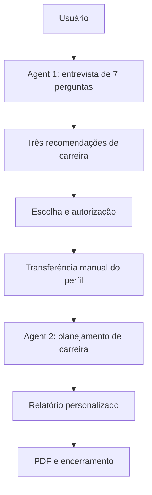

# IA Mentor de Carreira 360

**RC0.15 | Projeto acadêmico DIO | Sem finalidade comercial**

Adaptação educacional independente dos agentes de carreira disponibilizados no repositório oficial da Digital Innovation One (DIO). O objetivo é orientar o usuário na identificação de interesses, escolha de áreas de atuação em tecnologia e criação de um plano de aprendizagem personalizado.

> Este projeto é exclusivamente acadêmico e educacional, sem comercialização. Os créditos pelos prompts originais pertencem à DIO, aos seus instrutores e respectivos titulares. A contribuição do aluno consiste nos complementos operacionais, na adaptação do fluxo, na personalização e na documentação. Não é um produto oficial nem implica endosso da DIO. Consulte [Créditos e direitos](CREDITOS_E_DIREITOS.md).

## Como funciona

- **Agent 1:** entrevista, análise do perfil, recomendações justificadas e encaminhamento após autorização.
- **Agent 2:** atividades da profissão, competências, roadmap, portfólio, entrevistas e orientação sobre trilhas DIO.
- **Relatório:** gerado na conversa; PDF por recurso nativo da plataforma ou exportação manual, quando disponível.

## Como utilizar

Não é necessário instalar software, criar conta de desenvolvedor, configurar APIs, banco de dados ou servidor. É necessário ter acesso a uma plataforma de IA conversacional, sujeita aos seus próprios termos e limites.

1. Abra o [prompt original do Agent 1](https://github.com/digitalinnovationone/copilot-prompts/blob/main/AGENT%201%20-%20Entrevistador%20de%20Carreira%20em%20Tecnologia), copie-o para uma nova conversa e acrescente a seção de instruções de [AGENT1_COMPLEMENTO.md](AGENT1_COMPLEMENTO.md) antes de enviar.
2. Responda às sete perguntas, selecione uma carreira ou trajetória integrada, confirme a escolha e autorize o encaminhamento. Copie o bloco textual, sem dados identificantes.
3. Abra outra conversa com o [prompt original do Agent 2](https://github.com/digitalinnovationone/copilot-prompts/blob/main/AGENT%202%20-%20Planejador%20de%20Carreiras) e acrescente as instruções de [AGENT2_COMPLEMENTO.md](AGENT2_COMPLEMENTO.md). Envie o bloco de transferência.
4. Confira o plano e as horas. Solicite o PDF, se a plataforma oferecer essa função; caso contrário, copie ou imprima o relatório em PDF. Finalize o atendimento.

A comunicação entre os agentes é manual; o GitHub hospeda a documentação, não executa os agentes. Não há integração por API nem automação de servidor.

## Arquivos do projeto

| Arquivo | Conteúdo |
|---|---|
| `AGENT1_COMPLEMENTO.md` | Instruções complementares de entrevista e transferência |
| `AGENT2_COMPLEMENTO.md` | Instruções complementares de planejamento e encerramento em PDF |
| `DEMONSTRACAO.md` | Exemplo inteiramente fictício de uso |
| `RELATORIO_EXEMPLO.pdf` | Modelo de resultado final com dados fictícios |
| `VALIDACAO.md` | Registro sanitizado do teste e limites da validação |
| `CREDITOS_E_DIREITOS.md` | Procedência, finalidade acadêmica e direitos |

## Evidências e situação

- [Demonstração fictícia](DEMONSTRACAO.md) e [relatório PDF de exemplo](RELATORIO_EXEMPLO.pdf).
- Fluxo principal demonstrado em uma conversa em 26/11/2026 e aprovado pelo aluno. O relatório pessoal foi gerado separadamente e não integra este repositório.
- [Validação](VALIDACAO.md): distingue o teste aprovado de verificações não executadas em conversas independentes.
- RC0.15 documenta a aprovação e esclarece o encerramento em PDF. Não constitui nova homologação dos prompts em conversas separadas.

## Créditos e direitos

Fonte institucional: [DIO — copilot-prompts](https://github.com/digitalinnovationone/copilot-prompts). Os originais são acessados na fonte oficial e não são reproduzidos integralmente neste projeto. Não foi localizada licença explícita na consulta anterior de 26/11/2026. Atribuição e finalidade não comercial não substituem permissões aplicáveis. Nenhuma licença é atribuída aos materiais de terceiros.

## Limitações e privacidade

Orientação educacional, sem garantia de contratação, salários ou domínio profissional. Não publique conversas, dados pessoais ou relatórios reais. Ofertas de cursos devem ser conferidas diretamente na DIO; não se presume gratuidade. As recomendações podem variar entre plataformas e sessões.
